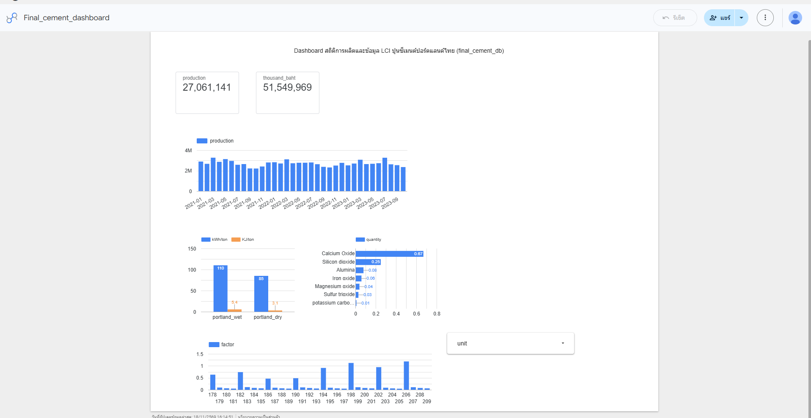
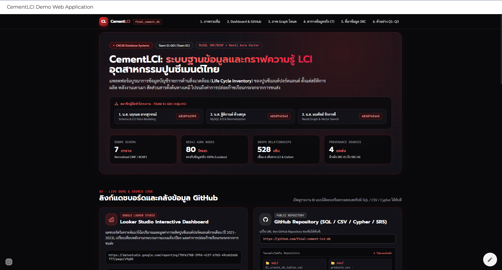

# final-cement-lci-db
CN230 Final Project (Team S1-601): Normalized MySQL LCI Database, Neo4j Graph + Vector Serving Layer &amp; Looker Studio Dashboard

# CementLCI: Thai Portland Cement LCI Database, Neo4j Graph + Vector Search & BI Dashboard & Web Demo

-4479A1?logo=mysql&logoColor=white)


**Course:** CN230 Database Systems (Final Project — Team `S1-G01` / Team 01)  
**Team Members:**
* น.ส. นฤกมล ลากสวรรณ์ (`6810742392`)
* น.ส. ฐิติกานต์ ด้วงสกล (`6810742343`)
* น.ส. มนพัทธ์ รักการดี (`6810742442`)

---

## Live Interactive Dashboard (Looker Studio)

**[Open Live Looker Studio Dashboard](https://datastudio.google.com/reporting/78fe1708-399d-4137-b7b5-49cd62ddb777/page/v9gDG)**

[](https://datastudio.google.com/reporting/78fe1708-399d-4137-b7b5-49cd62ddb777/page/v9gDG)

---


**[Open Demo LCI webapp](https://sites.google.com/view/reddit-cementlci-demo-web-app/reddit-cementlci-demo)**

[](https://sites.google.com/view/reddit-cementlci-demo-web-app/reddit-cementlci-demo)

---

## System Architecture

```text
MySQL 8.0 (Source of Truth, 3NF/BCNF, ACID)
   │  SELECT ... INTO OUTFILE (UTF-8 CSV + Provenance)
   ▼
GitHub CSV Data Layer (/csv/*.csv)
   │  LOAD CSV WITH HEADERS + Vector Embeddings (Cosine)
   ▼
Neo4j Aura Serving Layer (Graph Traversal + Semantic Search)
   │
   ▼
Looker Studio Interactive BI Dashboard
